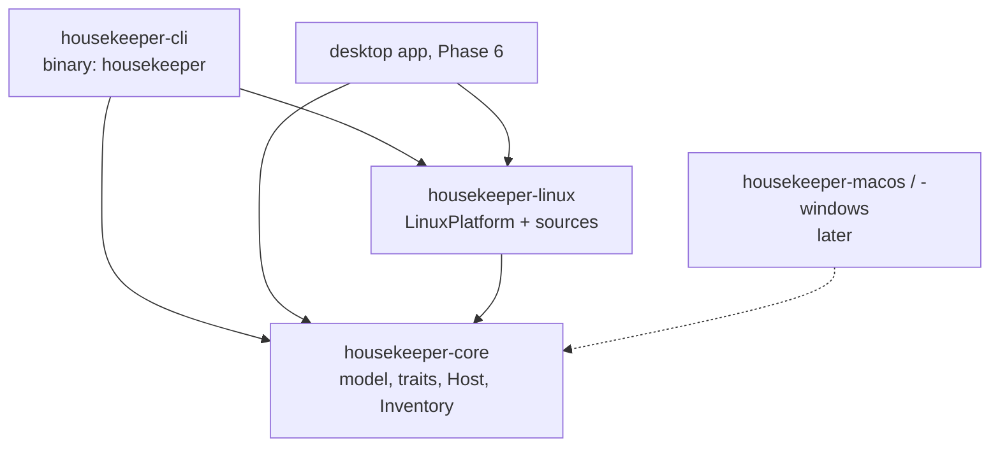

# Architecture

## Layers



- **`housekeeper-core`** knows nothing about any operating system. It defines the model (`Package`, `SourceInfo`),
  the extension points (traits), the `Host` that sources read the machine through, and services such as
  `Inventory`.
- **`housekeeper-linux`** implements a `Platform` for Linux and one `Source` per way software gets installed.
- **Front ends** (`housekeeper-cli`, later the Tauri app) pick the platform for the OS they were built for and talk
  only to core services.

Adding an operating system means adding one crate that implements `Platform` and its sources. Nothing in core or in
the Linux crate changes.

## Composition, not inheritance

Rust has no class inheritance; Housekeeper is assembled from small objects behind traits.

| Trait | Role | Implemented by |
|---|---|---|
| `Platform` | Describes the system and owns the list of sources | `LinuxPlatform` |
| `Source` | One way software gets installed: dpkg, Flatpak, npm… Reports availability and inventory | `DpkgSource`, `FlatpakSource`, … |
| `CommandRunner` | Runs a program (argv only, never a shell) with a timeout | `SystemRunner`, `FakeRunner` (tests) |

Capabilities that only some sources have are separate traits, exposed by a source as optional components rather than
as methods every source must stub out:

```rust
trait Source {
    fn info(&self) -> SourceInfo;
    fn probe(&self, host: &Host) -> Availability;
    fn inventory(&self, host: &Host) -> Result<Vec<Package>, SourceError>;
    // Added in later phases, each defaulting to None:
    // fn owner_lookup(&self) -> Option<&dyn OwnerLookup> { None }   // Phase 2
    // fn remover(&self) -> Option<&dyn Remover> { None }             // Phase 3
    // fn file_installer(&self) -> Option<&dyn FileInstaller> { None } // Phase 5
    // fn updater(&self) -> Option<&dyn Updater> { None }             // Phase 7
}
```

A front end asks "can this source remove things?" by checking for the component, so a new capability never forces
changes on sources that don't support it.

### The Host

Sources never touch `std::fs` paths or `std::process` directly. They go through `Host`:

- `host.path("/var/lib/dpkg/status")` resolves a system path under the host's root (`/` normally, a fixture
  directory in tests).
- `host.home()` and `host.var("CARGO_HOME")` give the user's home and environment.
- `host.run(&cmd)` executes through the injected `CommandRunner`.

This is what makes every source testable with recorded output and fixture files, and what will let the same sources
inspect another machine over SSH later (Phase 12) by swapping the runner.

## Decisions

Each challenge raised during design review, and the decision taken.

| # | Challenge | Decision |
|---|---|---|
| D1 | Package-manager output changes between versions (apt 3, dnf5) | Use stable machine interfaces only: `dpkg-query --showformat`, `rpm --queryformat`, pacman's local database files, the snapd REST API, metadata files for pipx, cargo and npm. Force `LC_ALL=C`. Keep fixtures per distro; smoke-test inside real distro containers in CI. |
| D2 | Several package managers can be present (rpm on Ubuntu) | Exactly one native backend, chosen from `os-release` (`ID`, then `ID_LIKE`); unknown distros fall back to probing dpkg → rpm → pacman. |
| D3 | Image-based distros (Silverblue, Kinoite) | Detect `/run/ostree-booted`. rpm lists the image; packages the user layered (`rpm-ostree status --json`) are the user's apps. Removal goes through `rpm-ostree` and needs a reboot, and the plan says so. |
| D4 | Running as root is dangerous | The app and CLI never run as root. Changes that need root go to a separate `housekeeper-helper` started with `pkexec`, which accepts one typed operation (JSON on stdin), validates names against the inventory and runs argv vectors, never shell strings. |
| D5 | Removing a package can drag system packages with it | Always simulate first through the package manager and show everything that would go. Protected packages (dpkg Essential / Priority required, pacman `base`, dnf `protected_packages`) block the plan. |
| D6 | Package-manager locks (apt running in the background) | Scans never take locks. Changes run one per backend at a time; a held lock shows as "waiting for apt" instead of failing. |
| D7 | Deleting leftovers loses data | Leftovers go to the freedesktop Trash. User data is only included when the user ticks it. |
| D8 | "Remove it the way its installer intended" for script installs | Tiered strategy (own uninstaller → package manager → format convention → recipe → tracked manifest → unknown). Recipes are TOML data files reviewed in this repo, using a fixed action vocabulary (run a program inside the install, trash a path under allowed roots), never free shell. TOML rather than YAML: `serde_yaml` is unmaintained. |
| D9 | Store pages are untrusted HTML shown in a privileged app (XSS) | Store data is fetched by the Rust backend, descriptions are converted to sanitised text, the webview has a strict CSP with no remote scripts, and the frontend only calls a small set of typed commands. |
| D10 | Store APIs are public but not guaranteed | Send a `User-Agent`, cache responses, ship a snapshot fallback, degrade to "store unavailable" without breaking the rest of the app. |
| D11 | Malicious apps in stores | Show source, publisher verification and sandbox permissions before install. Nothing installs without an explicit confirmation. |
| D12 | Slow scans | Sources are scanned in parallel threads. Read files directly where the format is stable (pacman, pipx, cargo, npm) instead of spawning interpreters. Commands have timeouts. |
| D13 | Async runtime | Core is synchronous and uses threads. The desktop app calls it on a blocking worker. No async runtime in core. |
| D14 | A failing source must not break the scan | Each source reports its own status (`ok`, `unavailable`, `failed: reason`); the rest of the inventory still shows. |
| D15 | Sign-in and telemetry | None in v1. Optional GitHub Gist backup later (Phase 12). |
| D16 | Distribution | Native packages built with [nfpm](https://nfpm.goreleaser.com) from one definition (`packaging/nfpm.yaml`): `.deb`, `.rpm`, Arch `.pkg.tar.zst`, plus a tarball, for x86_64 and aarch64, attached to every GitHub release. The desktop app's packages will also install the polkit policy and helper. Flatpak is not used: its sandbox cannot manage host packages. The AppImage runs in portable mode. |
| D17 | Name | "Housekeeper". "Linux" in a product name needs a Linux Foundation sublicence. |
| D18 | One binary for every distribution | The CLI is linked statically against musl, so the same file runs on old and new distributions regardless of their glibc. All dependencies are pure Rust, so this costs nothing. |
| D19 | Proving it works on each distribution | CI installs every package with the native package manager in containers of each supported release (Debian, Ubuntu, Fedora, AlmaLinux, openSUSE, Arch; x86_64 and aarch64), runs it against the real package database, checks it lists its own package, and removes it. Silverblue is checked from its official image using the tarball. |
