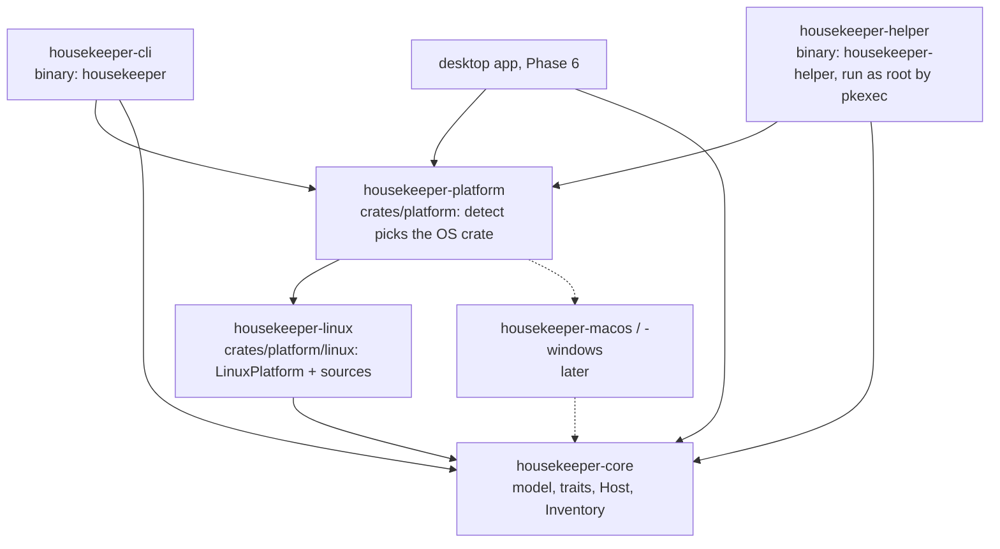

# Architecture

An illustrated walkthrough of this document, including a step-by-step example of adding a distribution, is in
[guide.html](guide.html) (open it in a browser).

## Layers



- **`housekeeper-core`** knows nothing about any operating system and builds on any of them. It defines the model
  (`Package`, `SourceInfo`), the extension points (traits), the `Host` that sources read the machine through, and
  services such as `Inventory`.
- **`housekeeper-linux`** (`crates/platform/linux`) implements a `Platform` for Linux and one `Source` per way
  software gets installed.
- **`housekeeper-platform`** (`crates/platform`) is the one place that knows which OS crate to use: `detect(&host)`
  returns the `Platform` for the OS it was built for, or `Unsupported`. Only it depends on the OS crates, which live
  inside its folder, one crate each (D27, D35).
- **Front ends** (`housekeeper-cli`, later the Tauri app) call `housekeeper_platform::detect` and then talk only to
  core services.
- **`housekeeper-helper`** (`crates/helper`) is the root helper (D4, D40): a separate binary that `pkexec` starts as
  root, which reads one typed request on standard input, checks it with core's `helper::carry_out` against the
  platform's package tool, runs the tool's own command and prints one reply. It never scans and never reads a home
  folder.

Adding an operating system means adding one crate in `crates/platform/<os>/` that implements `Platform` and its
sources, and registering it in `housekeeper-platform` (its `detect`, a target-specific dependency and the workspace
member list). Nothing in core, in the Linux crate or in the front ends changes.

## Composition, not inheritance

Rust has no class inheritance; Housekeeper is assembled from small objects behind traits.

| Trait | Role | Implemented by |
|---|---|---|
| `Platform` | Describes the system, owns the list of sources, and lists the application menu's launchers, the app catalog entries on disk, the folders commands live in, the per-user folders programs keep their state in, and the shell startup files | `LinuxPlatform` (desktop entries, AppStream metainfo, `PATH` plus the standard program folders, the XDG base directories and `~/.var/app`, bash/zsh/fish startup files) |
| `Source` | One way software gets installed: dpkg, Flatpak, Homebrew, npm… Reports availability and inventory | `DpkgSource`, `FlatpakSource`, `HomebrewSource`, … |
| `LinuxSource` | How a Linux source is created, and whether it is a distribution's native package manager | every Linux source |
| `OwnerLookup` | Optional ability: which installed packages own each of a set of paths | `DpkgSource`, `RpmSource`, `PacmanSource` |
| `FileList` | Optional ability: the files one package installed, as the source records them | `DpkgSource`, `RpmSource`, `PacmanSource`, `PipSource` (`RECORD`), `CargoSource` (its binaries) |
| `Dependants` | Optional ability: which installed packages of the same source directly need one package | `DpkgSource`, `RpmSource`, `PacmanSource`, `FlatpakSource` (apps on a runtime), `SnapSource` (base and content snaps) |
| `Remover` | Optional ability: how one package would be removed, as a `RemovalPlan` (D31). Plans only until Phase 4 | Native sources through their package tool; Flatpak, Snap, Homebrew, npm, pipx, uv, pip, cargo; AppImage (its format's convention); manual (rustup's own uninstaller) |
| `Simulator` | Optional ability of a remover: everything that removing one package would take, and why the package manager would refuse, without root (D33) | `Apt` (`apt-get --simulate`), `Pacman` (`pacman --remove --print`), `Dnf` and `Zypper` (the RPM database) |
| `PackageRemoval` | What the root helper needs from the system's package tool: its name, whether the package database lists a package as installed, and the command that removes packages, the same one plans show (D40) | `Apt`, `Dnf`, `Zypper`, `RpmOstree`, `Pacman`, through `Platform::package_removal` |
| `PackageLock` | Whether another program holds a backend's lock, and who, without taking it (D6, D41) | `Apt` (dpkg's locks in `/proc/locks`), `Dnf` (the RPM database's), `Zypper` (`/run/zypp.pid`, then the RPM database's), `Pacman` (`db.lck`), through `Platform::package_lock` |
| `RootHelper` | How front ends reach the root helper (D40, D44) | `Pkexec` (Linux: the installed helper through `pkexec`, or directly when already root), through `Platform::root_helper` |
| `Job` | One change for the operation queue (`Queue`), with the backend it changes (D41) | the removal steps in 4.5 |
| `PackageTool` | The program a distribution changes its packages with (D24); offers abilities to its native source | `Apt`, `Dnf`, `Zypper`, `RpmOstree`, `Pacman` |
| `CommandRunner` | Runs a program (argv only, never a shell) with a timeout | `SystemRunner`, `FakeRunner` (tests) |

Abilities that only some sources have are separate traits, exposed by a source as optional components rather than
as methods every source must stub out:

```rust
trait Source {
    fn info(&self) -> SourceInfo;
    fn probe(&self, host: &Host) -> Availability;
    fn inventory(&self, host: &Host, scan: &ScanContext) -> Result<Vec<Package>, SourceError>;
    fn owner_lookup(&self) -> Option<&dyn OwnerLookup> { None }      // native package managers
    fn file_list(&self) -> Option<&dyn FileList> { None }            // package managers, pip, cargo
    fn dependant_lookup(&self) -> Option<&dyn Dependants> { None }   // package managers, Flatpak, Snap
    fn remover(&self) -> Option<&dyn Remover> { None }               // how a package is removed (plans only)
    fn install_roots(&self, host: &Host) -> Vec<PathBuf> { vec![] }  // where its programs live (pipx, npm…)
    fn leftover_roots(&self, host: &Host) -> Vec<(PathBuf, LeftoverKind)> { vec![] } // its items' own state (Flatpak)
    // Added in later phases, each defaulting to None:
    // fn file_installer(&self) -> Option<&dyn FileInstaller> { None } // Phase 5
    // fn updater(&self) -> Option<&dyn Updater> { None }             // Phase 7
}
```

A front end asks "can this source remove things?" by checking for the component, so a new capability never forces
changes on sources that don't support it.

### Adding a provider is one file

Every file in `crates/platform/linux/src/sources/` is a source and registers itself: the Linux crate's `build.rs`
declares the file as a module and adds its `PROVIDER` to the generated provider list, and the file defines `PROVIDER`
with `register!(<Type>);`. Nothing else is edited. A file without `register!` fails to compile.

```rust
// crates/platform/linux/src/sources/homebrew.rs (the whole registration)
pub struct HomebrewSource;

impl LinuxSource for HomebrewSource {
    fn create(_: &Context<'_>) -> Self { Self }
}
register!(HomebrewSource);
impl Source for HomebrewSource { /* info, probe, inventory */ }
```

A distribution's own package manager also declares which distributions it serves, so supporting a new distribution
is the same single file:

```rust
impl LinuxSource for DpkgSource {
    const NATIVE: Option<Native> = Some(Native {
        families: &[Family { name: "debian", distro_ids: &["debian", "ubuntu", "linuxmint", /* … */] }],
        program: "dpkg-query",
    });
    fn create(_: &Context<'_>) -> Self { Self }
}
```

`LinuxPlatform` matches the distribution's `ID`, then each `ID_LIKE` entry, against every native source's families,
and creates that one native source and every other source. It never names a source.

Sources never hold each other. While a source is read, its `ScanContext` gives it every source of the platform
and a place for warnings (D23). The manual source uses it to leave out what others account for: paths a native
source's `owner_lookup()` says it owns, and programs that resolve into another source's `install_roots()`.

The same three answers make `Housekeeper::who` ("who installed this?") in core: for a command or file it follows
the symlinks and, file by file, takes the first source that accounts for one: a package database that lists it
(`owner_lookup()`), a package whose install location contains it (`Package::location`, the deepest one along the
chain), or a source folder that contains it (`install_roots()`). It names no source, so a new source is covered as
soon as it reports locations or install roots.

Every scan uses the same evidence, in one batch, to give packages their launchers and commands (D28): each desktop
entry (the file, then the files it hides, then the program its `Exec` starts) and each program in the command
folders is traced to its package, but a command counts only when a package database lists it. A package with a menu
entry or a command is an `App`; one whose package database answered and that has neither is a `Component` (fonts,
firmware, data), which `housekeeper list` hides without `--all`. The main launcher gives a title and an icon when
the source has none.

The same pass reads the app catalog entries on disk (`Platform::metainfo`: AppStream metainfo on Linux) and gives
their component IDs to the package that accounts for the file, or else to the package whose launcher the entry names.
Sources that know their packages' AppStream IDs report them too (a Flatpak's ID, a snap's `common-id`). The scan then
groups the apps installed more than once (`Scan::groups`, D29): installs that share an AppStream or launcher ID, a
name or a command. Packages stay separate; a group only lists them and what they share.

`Housekeeper::show` takes one package from a scan and adds what only that package needs (D30): its files, from the
source's `file_list()` when the source records them, otherwise everything in its install location; the packages of
the same source that directly need it, from `dependant_lookup()`; and its other installs from the scan's groups.

`housekeeper show` also asks the source's `remover()` for a `RemovalPlan` (D31): the tier it comes from (own
uninstaller, package manager, format convention, recipe, tracked manifest, unknown; D8), the steps in order, each
marked as run by the user or by the root helper (D25), what blocks the plan, and whether a restart is needed. A source
without a remover gives an `Unknown` plan. Core blocks the plan of a protected package whatever the source planned:
`Package::protected` holds why removing it could break the system (D32), and the plan keeps its steps so the reader
sees what it would take. Any other package is simulated when its remover offers a `Simulator` (D33): the simulation
lists every package that would go with it, and core blocks the plan when the package manager refuses or when one of
those is protected. `show` also lists what the item would leave behind (D36): folders named after it in the
platform's per-user state folders (`Platform::leftover_roots`, for items outside a sandbox) or its source's own
(`Source::leftover_roots`, Flatpak's `~/.var/app`), and lines in shell startup files
(`Platform::shell_files`) that mention its own install folder. `show` only counts the folders;
`Housekeeper::measure_leftovers` sizes them, at most `MEASURE_BUDGET` (50,000) files and folders each, and
`housekeeper remove --dry-run` prints the plan with all of them, measured.

`housekeeper remove` carries a plan out (D44): `Housekeeper::still_as_reviewed` plans again and compares (D37), then
`Housekeeper::remove` runs the steps in order as one job of the operation queue (D41), as the user or through the
platform's `RootHelper` (`pkexec` and the installed helper, D40), stops at the first that fails, moves the leftovers
the user chose to the Trash (D43) only when every step was done, and appends the outcome to the history (D42).

### Installer files

`housekeeper inspect <file>` says what a downloaded file is before anything installs it (D45). Each Linux source
declares the formats whose software it lists once installed, next to `NATIVE`:

```rust
impl LinuxSource for DpkgSource {
    const FILES: &'static [FileFormat] = &[FileFormat {
        id: "deb",
        title: "Debian package",
        suffixes: &[".deb"],                                     // the name must end so…
        matches: is_deb,                                         // …and the first bytes must agree
        evidence: "an `ar` archive whose first member is `debian-binary`",
        read: read_deb,                                          // name, version, processor (`dpkg-deb --show`)
    }];
    /* NATIVE, create */
}
```

`LinuxPlatform` keeps every provider's formats, the native sources it did not pick included, so a `.deb` on Fedora is
recognised and named as Debian's. `Platform::recognise_file` reads the file's first kilobyte, keeps the formats whose
name ending and first bytes both match (the longest ending wins: `.pkg.tar.zst` is pacman's, `.tar.zst` an archive),
and lets the format read what is inside, from the file or with the format's own tool where this system has it
(`dpkg-deb`, `rpm`, `bsdtar`, `unsquashfs`). `Housekeeper::inspect` in core then decides whether it fits: another
distribution's own format does not, nor one whose source is not available here (a `.snap` without snapd), nor one
built for another processor. Nothing in the file is run. Archives, scripts and `.run` programs are the manual source's.

### Package tools

A native source only reads its package database. What changes it is the distribution's **package tool** (D24): one
file per tool in `crates/platform/linux/src/tools/`, registered like a source with `register_package_tool!(<Type>);`,
that declares the families it serves and whether it is the tool of their image-based systems:

```rust
impl LinuxTool for RpmOstree {
    const SERVES: Serves = Serves { families: &["fedora"], image_based: true };
    fn create() -> Self { Self }
}
```

`LinuxPlatform` takes the family the native source was picked for and creates the first tool that serves it (dnf on
Fedora, rpm-ostree on Silverblue, zypper on openSUSE), and hands it to the native source in its `Context`. The native
source's `remover()` is the tool's. A distribution that no family claims gets no tool, so nothing guesses how to change
its packages.

### Recipes

A tool installed by its own script (rustup, nvm, pyenv…) is one reviewed TOML file in `crates/platform/linux/recipes/`
(D26, D34). The file says how to find the tool (candidate folders, the environment variables that move them, a marker
file) and how to remove it, with a fixed vocabulary: run the tool's own uninstaller (a program inside the install, as
the user) or move paths inside the install to the Trash. `build.rs` compiles every file in; `recipe.rs` parses and
checks them, and the manual source lists what they find (`installer/<file name>`) and plans removals from them.

```toml
# crates/platform/linux/recipes/bun.toml
title = "Bun"

[detect]
roots = [{ var = "BUN_INSTALL", default = ".bun" }]
marker = "bin/bun"

[remove]
trash = ["."]
```

### The Host

Sources never touch `std::fs` paths or `std::process` directly. They go through `Host`:

- `host.path("/var/lib/dpkg/status")` resolves a system path under the host's root (`/` normally, a fixture
  directory in tests).
- `host.home()` and `host.var("CARGO_HOME")` give the user's home and environment.
- `host.run(&cmd)` executes through the injected `CommandRunner`.

This is what makes every source testable with recorded output and fixture files. The runner is swapped only for tests:
Housekeeper inspects the machine it runs on and no other (D22).

## Decisions

Each challenge raised during design review, and the decision taken.

| # | Challenge | Decision |
|---|---|---|
| D1 | Package-manager output changes between versions (apt 3, dnf5) | Use stable machine interfaces only: `dpkg-query --showformat`, `rpm --queryformat`, pacman's local database files, the snapd REST API, metadata files for pipx, cargo and npm. Force `LC_ALL=C`. Keep fixtures per distro; smoke-test inside real distro containers in CI. |
| D2 | Several package managers can be present (rpm on Ubuntu) | Exactly one native source, chosen from `os-release` (`ID`, then each `ID_LIKE` entry) against the families each native source declares; on a distribution no family claims, the first native source (in file-name order) whose program is installed. |
| D3 | Image-based distros (Silverblue, Kinoite; openSUSE Aeon, MicroOS) | Detect `/run/ostree-booted`. rpm lists the image; packages the user layered (`rpm-ostree status --json`) are the user's apps. Removal goes through `rpm-ostree` and needs a reboot, and the plan says so. openSUSE's image-based systems use `transactional-update` instead of rpm-ostree; they are detected and handled by their own package tool (D24). |
| D4 | Running as root is dangerous | The app and CLI never run as root. Changes that need root go to a separate `housekeeper-helper` started with `pkexec`, which accepts one typed operation (JSON on stdin), checks each name against the native package database itself (D25) and runs argv vectors, never shell strings. |
| D5 | Removing a package can drag system packages with it | Always simulate first through the package manager and show everything that would go (D33). Protected packages (dpkg Essential / Protected / Priority required, pacman `base`, dnf `protected_packages`, the running kernel; D32) block the plan, and so does a simulation that would take one of them along. |
| D6 | Package-manager locks (apt running in the background) | Scans never take locks. Changes run one per backend at a time; a held lock shows as "waiting for apt" instead of failing. |
| D7 | Deleting leftovers loses data | Leftovers go to the freedesktop Trash. User data is only included when the user ticks it. |
| D8 | "Remove it the way its installer intended" for script installs | Tiered strategy (own uninstaller → package manager → format convention → recipe → tracked manifest → unknown). Recipes are TOML data files reviewed in this repo, using a fixed action vocabulary (run a program inside the install, trash a path under allowed roots), never free shell. TOML rather than YAML: `serde_yaml` is unmaintained. |
| D9 | Store pages are untrusted HTML shown in a privileged app (XSS) | Store data is fetched by the Rust backend, descriptions are converted to sanitised text, the webview has a strict CSP with no remote scripts, and the frontend only calls a small set of typed commands. |
| D10 | Store APIs are public but not guaranteed | Send a `User-Agent`, cache responses, ship a snapshot fallback, degrade to "store unavailable" without breaking the rest of the app. |
| D11 | Malicious apps in stores | Show source, publisher verification and sandbox permissions before install. Nothing installs without an explicit confirmation. |
| D12 | Slow scans | Sources are scanned in parallel threads. Read files directly where the format is stable (pacman, pipx, cargo, npm) instead of spawning interpreters. Commands have timeouts. `Housekeeper::scan_with` hands each source's result to a callback as soon as that source finishes, so the desktop app can show progress per source. |
| D13 | Async runtime | Core is synchronous and uses threads. The desktop app calls it on a blocking worker. No async runtime in core. |
| D14 | A failing source must not break the scan | Each source reports its own status (`ok`, `unavailable`, `failed: reason`); the rest of the inventory still shows. |
| D15 | Sign-in and telemetry | None in v1. Optional GitHub Gist backup later (Phase 12). |
| D16 | Distribution | Native packages built with [nfpm](https://nfpm.goreleaser.com) from one definition (`packaging/nfpm.yaml`): `.deb`, `.rpm`, Arch `.pkg.tar.zst`, plus a tarball, for x86_64 and aarch64, attached to every GitHub release. The desktop app's packages will also install the polkit policy and helper. Flatpak is not used: its sandbox cannot manage host packages. The AppImage runs in portable mode. |
| D17 | Name | "Housekeeper". "Linux" in a product name needs a Linux Foundation sublicence. |
| D18 | One binary for every distribution | The CLI is linked statically against musl, so the same file runs on old and new distributions regardless of their glibc. All dependencies are pure Rust, so this costs nothing. |
| D19 | Proving it works on each distribution | CI installs every package with the native package manager in containers of each supported release (Debian, Ubuntu, Fedora, AlmaLinux, openSUSE, Arch; x86_64 and aarch64), runs it against the real package database, checks it lists its own package, and removes it. Silverblue is checked from its official image using the tarball. |
| D20 | Adding a provider must not mean editing lists | Every file in `crates/platform/linux/src/sources/` implements `Source` + `LinuxSource` and calls `register!(<Type>)`, which defines its `PROVIDER`. `build.rs` only lists the files: it declares one module per file and adds its `PROVIDER` to the generated list, so the compiler reports a file without `register!`. Sources never import from each other; code they share lives outside `sources/` (`files.rs`, `python.rs`). Native package managers declare their families in the same file and offer `OwnerLookup` themselves. Explicit registration (one line per source) was the alternative; generated registration was chosen so a provider is exactly one file. Finding `impl LinuxSource for` in the source text was tried first and dropped: comments and strings fooled it and the compiler could not check it. |
| D21 | Licence: nobody may turn Housekeeper into closed software | GNU GPL v3.0 or later. Anyone distributing it, modified or not, must provide the source under the same licence. "Or later" (the FSF's recommendation) lets the project move to a future GPL version without asking every contributor. MIT and Apache-2.0 were rejected because they allow closed forks; AGPL was not needed because Housekeeper is not a network service. Dependencies stay permissive (MIT, Apache-2.0, Unicode-3.0), all GPL-compatible; `cargo deny` enforces it. |
| D22 | Managing other computers (over SSH) | Not planned. Housekeeper manages only the machine it runs on; `Host` and `CommandRunner` stay local, and the runner is swapped only for tests. Earlier documents disagreed on how it would work (swap the runner, run `housekeeper --json` on the other machine, install nothing there), and swapping the runner alone could not work because `Host` reads files locally. Bringing it back needs a new decision that picks one design. |
| D23 | Sources that depend on other sources (the manual source must leave out what package managers, pipx, npm… installed) | Sources reach each other only at scan time, through the `ScanContext` passed to `inventory`: it lists every source of the platform and collects warnings. Each source declares where its programs live (`install_roots`), so a new source is never listed twice as a hand install and no other file knows its directories. A source that cannot fully answer (an owner lookup that times out) still reports what it found, with a warning, instead of failing. Construction-time wiring (`Context` holding the native source) was replaced because every new dependency between sources needed a new field. |
| D24 | Reading packages and changing them are different jobs: rpm is read on Fedora, openSUSE and Silverblue, but changed through dnf, zypper or rpm-ostree (and dpkg through apt, pacman's AUR through paru or yay) | The native source reads the package database (dpkg, rpm, pacman) and stays one per system (D2). Changing packages (simulate, remove, install, update, hold) belongs to a **package tool**: one file per tool (apt, dnf, zypper, rpm-ostree, transactional-update, pacman, an AUR helper) in its own folder of the Linux crate (`src/tools/`), registered like sources (D20), declaring the families or `os-release` IDs it serves and when it applies (image-based or not). `LinuxPlatform` picks the tool the same way it picks the native source, and the native source's `remover()` and later abilities come from that tool. A database file therefore never branches on distribution, and a distribution that shares a database but not a tool (Mageia, PCLinuxOS) is one new tool file. Settled before Phase 3.1. |
| D25 | Who carries out a removal | Every step of a removal plan says who runs it: the user, or the root helper (D4). Items in the user's own scope (npm under nvm or fnm, pipx, uv, cargo, `pip --user`, `~/.local`, user Flatpaks, Homebrew) are removed as the user. Tools that authorise system changes themselves (snapd, Flatpak's system helper) also run as the user and ask through polkit on their own. The root helper only takes what needs root and has no such tool: operations of the native package tool (D24), and recipe actions on system paths under D8's allowed roots (such as `/opt`). It checks each package name against the package database itself (`dpkg-query`, `rpm -q`, pacman's database) and never runs a scan: as root, the home directory and environment are root's, so user-scope sources would read the wrong places, and the helper would carry code it does not need. |
| D26 | A script-installed tool is described in two places (detection in Rust, removal in a recipe) | One TOML recipe per tool (D8) holds both: how to detect it (install roots, the environment variables that move them, a marker file) and how to remove it. The manual source reads its list of script installers from the recipes, which are compiled into the binary so it stays one file. The Rust `INSTALLERS` table in `manual.rs` moved into recipes in plan 3.4 (D34). Adding a script-installed tool is one reviewed TOML file and no Rust. |
| D27 | Core must build on any OS, and every front end must pick the platform the same way | Core keeps Unix-only code (execute bits in `host.rs` and `command.rs`) behind `cfg(unix)`; elsewhere any file counts as executable. A small crate, `housekeeper-platform`, exposes `detect(&host) -> Result<Box<dyn Platform>, Unsupported>` and is the only crate that depends on an OS crate, each as a target-specific dependency. Front ends call it and depend on core otherwise. The alternative, each front end keeping its own `cfg(target_os)` functions, was rejected: the desktop app would have to copy them and could drift from the CLI. |
| D28 | Telling apps from the rest of a native package database: dpkg, rpm and pacman say nothing about which packages a person launches, so every package someone marked as installed on purpose was listed (448 on an Ubuntu desktop: fonts, firmware, Python modules, data) | A package is an `App` when it has a launcher shown in the application menu or a command a package database lists in the command folders, and a `Component` (hidden without `--all`) when its package database answered and it has neither. The platform lists launchers (`Platform::launchers`: desktop entries on Linux, read as the freedesktop.org specification says, one per desktop ID, the one that takes precedence) and command folders (`Platform::command_dirs`: the `PATH` plus the standard program folders); core attaches both with `who`'s evidence (D23), in one batched ownership query per package database that runs while the sources are read. A launcher goes to the first of its file, the files it hides, and its `Exec` program that a source accounts for, so a user's copy of a Flatpak entry stays with the Flatpak app rather than the `flatpak` package its command line runs. Each source reporting its own launchers was rejected: the evidence chain would be repeated in every source and a desktop file in `~/.local` names no source. Classifying by package section or name (`fonts-*`, `Section: libs`) was rejected: it differs per distribution and misses data packages with ordinary names. rpm lists every installed file once (`rpm -qa`) instead of `rpm -qf` when more than 64 paths are asked, because `rpm -qf` prints an owning package's whole file list once per path. |
| D29 | The same app installed more than once (a `.deb` and a snap, npm under two Node versions) shows as unrelated rows, but merging them would hide which copy runs and how each is removed | Packages stay separate; `Scan::groups` lists the installs of one app and what they share. Two packages are linked when they share an AppStream ID (catalog entries attached like launchers, a Flatpak's ID, a snap's `common-id`), a launcher ID (compared with AppStream IDs, without `.desktop` or case), a name or title (lowercase letters and digits), or a command, and links are followed transitively. Only `App` packages take part: libraries and components of one name are parts, not installs. Within one source only packages of the same name are linked, because a package database splits one install into parts that share a title (`vim` and `vim-common`). Matching on AppStream IDs alone was rejected: on an Ubuntu desktop no two installs shared one, while names, titles and commands found all four real duplicates. A name match can join unrelated software that shares a name; the group lists what was shared so the evidence is visible. |
| D30 | `housekeeper show` needs a package's files and what depends on it, which only some sources record, and an install location is not always the package's alone (every `cargo install` shares `~/.cargo/bin`; a pip package's location is its `.dist-info` folder) | Two optional abilities, `FileList` (`file_list()`) and `Dependants` (`dependant_lookup()`), offered by the sources that record them: dpkg (`dpkg-query --listfiles`, Depends/Pre-Depends against the package's name and Provides), rpm (`rpm -ql`, `--whatrequires` on what it provides), pacman (its local database's `files` and `%DEPENDS%`/`%PROVIDES%`), pip (`RECORD`), cargo (its binaries), Flatpak (apps on a runtime) and Snap (snaps on a base or using its content). Without `FileList`, a package's files are everything in its install location, symlinked folders listed but not entered. Dependants are direct only and within one source: the full set a removal would take is the package manager's simulation (plan 3.3). Optional dependencies (Recommends, optdepends) do not count. The text shows the first 10 dependants and the full list is in `--json`; the file list is printed only with `--files`. The accessor is `dependant_lookup()`, not `dependants()`, so it does not clash with the trait's own method. |
| D31 | A removal plan must be reviewable now and carried out later (Phase 4) without being rebuilt, and the root helper must never take a command line from an unprivileged process | `Source::remover()` offers a `Remover` that makes a `RemovalPlan`: its tier (D8), its steps in order, each marked as run by the user or by the root helper (D25), what blocks it, and whether a restart is needed. Steps are typed: run a program (argv), move a path to the Trash, or remove packages through the package tool; the last carries the tool and the package names, which is all the helper will be given (it builds the command itself), plus the command for review. Native sources get their remover from the package tool (D24), picked by the family the native source serves and whether the system is image-based; a distribution no family claims gets none. Language package managers installed outside the home folder (a system npm prefix, a system cargo root) are blocked rather than run as root, because the helper only runs the system's package tool and npm runs package scripts. rpm-ostree only uninstalls what the user layered; the image's own packages are blocked (hiding them with `override remove` is not removing what the user installed). An AppImage's file and the launchers that start it are trashed, by the helper when outside the home folder, like D25's recipe actions on system paths; launcher files they hide are left alone. Hand installs and script installers other than rustup stay `Unknown` until recipes (plan 3.4). |
| D32 | A protected package must say why, and protection must not stop what the package manager allows (Fedora and Arch protected every installed kernel, so an old one could not be removed) | `Package::protected` is the reason, not a flag (`dpkg marks it Essential`, `listed in dnf's protected packages (/etc/dnf/protected.d/sudo.conf)`, `the base metapackage needs it`, `it is the running kernel`); the scan's JSON `schema` went to 2 for it. Each native source reads its manager's own marks: dpkg's `Essential`, `Protected` (newer dpkg) and `Priority: required`; dnf's `protected.d` lists and `protected_packages` in `dnf.conf`; pacman's `base` metapackage and everything it depends on, by name or through what a package provides. A short core list (C library, init, shell, core commands, package managers) is kept for systems that mark nothing. Kernels are protected only while running, as dnf's `protect_running_kernel` does: the release (`/proc/sys/kernel/osrelease`) gives the image (`/usr/lib/modules/<release>/vmlinuz` or `/boot/vmlinuz-<release>`), and the native source names the exact install that owns it (rpm by NEVRA, because several kernels share a name). A failed ownership query is a warning, not a failed scan. Core adds `protected: <reason>` to the plan's blockers, so every source's plan is covered without each remover checking. |
| D33 | Simulating a removal through the package manager (D5) needs root with dnf4 (RHEL, AlmaLinux) and zypper, and Housekeeper never runs as root before the helper exists (D4) | A remover may offer a `Simulator`, which says, without root, every package of the source that would go and why the package manager would refuse. apt and pacman answer themselves: `apt-get --simulate remove` (its `Remv` lines, mapped to dpkg ids; `E:` messages are a refusal) and `pacman --remove --print` (pacman refuses when another package needs it). dnf and zypper remove what needs a package along with it, so their simulation is the RPM database's: the package and every installed package that requires something it provides or one of its programs, level by level (`rpm -q --whatrequires`). On Fedora 45 this matched dnf's own count exactly (32 packages with `gmp`, without its unused-dependency cleanup); on Tumbleweed it matched zypper's 27 for `libacl1` plus one pattern package. dnf5's own `--assumeno` works without root but prints only a human table (D1), so it is not parsed. rpm-ostree, Flatpak, Snap and the language tools have no simulator yet. Core simulates only packages that are not protected, blocks the plan on a refusal or on a protected package in the result, and turns a failed simulation into a warning. |
| D34 | A recipe is data that ends up deciding what gets deleted, so a mistake or a hostile edit must not reach outside the tool's own folder | Recipes live in the Linux crate's `recipes/` folder, one per tool, named by the tool's key; `build.rs` compiles each in with `include_str!`, so they are reviewed like code and nothing is read from disk at run time. Every table rejects unknown keys (`deny_unknown_fields`), so an action outside the vocabulary is an error, not ignored. Detection: candidate roots (`{ var, default }`, `{ home }` or an absolute `{ path }`) and a marker file. Removal is exactly one of: `uninstaller`, a program inside the install root or the marker's root with fixed arguments, run as the user (tier "own uninstaller"); or `trash`, paths inside the install root (tier "recipe"), trashed by the user in the home folder and by the root helper elsewhere. Every relative path is checked: not absolute, no `..`. A trash path that is the home folder, an ancestor of it or `/` (a variable pointing the root there) blocks the plan instead. A recipe without `[remove]` plans "unknown": Homebrew's uninstaller is a downloaded script, and Oh My Zsh's folder cannot go without editing `~/.zshrc` (Phase 8). Lines other tools added to shell startup files are not edited yet either. A recipe that does not parse is a scan warning; the tests parse every built-in one. |
| D35 | Where operating-system crates live: `crates/linux` sat next to `crates/platform`, the crate that picks it, so the layout did not show that one chooses among the others | Each OS crate lives inside the selector's folder, `crates/platform/<os>/` (today `crates/platform/linux`), as its own crate: the selector depends on it by path and only for that OS (D27), each OS crate keeps its own build script, tests and dependencies, and core stays free of OS knowledge. The workspace lists nested OS crates by name (`crates/platform/linux`), because a `crates/platform/*` pattern would also match the selector's `src/`. Making Linux a module of the selector was rejected: one crate full of `cfg(target_os)` would mix every OS's build script and dependencies. Old change records keep the old paths; they describe history. |
| D36 | What a removal leaves behind (settings, caches, data, shell lines) must be shown, but guessing wrong would put someone's files or another app's state in the Trash | Leftovers are found, not removed. A folder counts when it sits directly in a folder the item keeps per-user state in and its name equals, ignoring case, the item's name, one of its AppStream IDs or one of its launcher IDs. Those folders are the platform's (`Platform::leftover_roots`; Linux: the XDG config, cache, data and state homes) for items outside a sandbox, and the item's own source's (`Source::leftover_roots`: Flatpak's `~/.var/app`, which `flatpak uninstall` keeps) for that source's items only. A sandboxed item (`Package::sandboxed`: every Flatpak, a strict or devmode snap, whose XDG folders are redirected into `~/.var/app/<id>` or `~/snap/<name>`) has no leftovers in the platform's folders, and no other source's item has leftovers in Flatpak's (change 0042: a `.deb` with a Flatpak's AppStream ID used to claim its `~/.var/app` folder). `~/snap` is no one's: `snap remove` takes it along. Exact names only, no prefixes; folders several programs share never count, even when a package carries their name (`Platform::shared_state_folders`; Linux: `applications`, `fonts`, `icons`, GTK's settings, `dconf`, which Fedora, openSUSE and Arch ship a package for, and more), nor do folders that hold an install (a package's location, a source's install root: `~/.local/share/flatpak` is not the `flatpak` package's leftover). Every folder carries its kind; only caches may go without the user choosing (D7). A folder whose name also matches another installed item that uses the same folders lists it (a `.deb` and a classic snap of one app share `~/.config/<name>`; two installations of one Flatpak share `~/.var/app/<id>`), and a folder of a language package says that copies Housekeeper does not read (a virtual environment, a project's own packages) may use it too. Shell lines are lines in the platform's shell startup files that mention the item's own install folder (absolute, `$HOME/…`, `${HOME}/…` or `~/…`, not a longer name that starts or ends the same), only for items installed in a folder of their own in the home folder; a folder inside a source's install root or shared with another item (`~/.cargo/bin`) belongs to the source. Lines are listed, not edited (Phase 8). Home dot-folders (`~/.vim`, `~/.mozilla`) are not searched yet: their names rarely match the package and often hold irreplaceable data. |
| D37 | A removal is reviewed (`remove --dry-run`, the plan view) and carried out later; in between, a leftover folder can be swapped for a symlink or moved, and a package upgraded, replaced or newly protected, so acting on the plan as reviewed could trash or remove something nobody reviewed | Nothing from a plan is trusted when it is carried out (4.4, 4.5). Each leftover records, when found, the identity of its folder (device and inode) and its owner. Before moving it to the Trash, Housekeeper opens every component of its path without following symlinks, checks that it is still a direct child of the leftover folder it was found in, and that device, inode and owner are unchanged; any difference skips that folder and says why. Packages are checked again the same way: the same version still installed, still not protected (D32), and simulated again (D33); a different answer stops the removal before anything changes. The root helper repeats its own checks (D25) whatever the caller says. |
| D38 | Which leftovers a removal takes unless the user says otherwise: D7 includes user data only when ticked, but does not say which caches are safe | Preselected: a cache folder (`LeftoverKind::Cache`) with no other installed item using it (`also_used_by` empty) and no copies Housekeeper does not read (`unseen_copies` false). Everything else is listed unticked: settings, data and state, any folder another install may use, and folders of language packages. Shell lines are listed and never edited before Phase 8, which edits only Housekeeper-managed blocks. |
| D39 | Scanning on every start is slow for the desktop app, but a stored scan goes stale when package managers change things behind Housekeeper's back | No scan cache before the desktop app (Phase 6): a full scan takes under a second for the CLI. From Phase 6 the last scan may be shown at once and refreshed in the background; each source then also reports a cheap fingerprint of its database (the modification time of `/var/lib/dpkg/status`, the RPM database, pacman's local folder, Flatpak's installations; snapd's change ID) to tell which parts are stale. A stored scan is only ever shown: plans, simulations, the root helper and every removal read the live system (D37). Files are JSON under `$XDG_CACHE_HOME/housekeeper` (the scan) and JSONL under `$XDG_STATE_HOME/housekeeper` (history and the record of items seen, 4.3, which also names the leftovers of apps removed outside Housekeeper in Phase 10); no database. |
| D40 | The root helper (D4) is the one part of Housekeeper that runs as root, so whatever reaches it from an unprivileged process must not be able to make it do anything but the change the user reviewed | `housekeeper-helper` is its own binary, installed outside the `PATH` at `/usr/lib/housekeeper/housekeeper-helper` (a path every distribution allows, unlike `/usr/libexec` on Arch) and started by `pkexec` under the polkit action `io.github.mhsiddiqui.housekeeper.helper`, which asks for an administrator's password every time (`auth_admin`, nothing kept). It reads one JSON request of at most 64 KiB, `{ "protocol": 1, "operation": { "kind": "remove-packages", "tool", "packages" } }` or `{ "kind": "trash", "path" }`, with unknown fields and kinds rejected, and prints one reply (`done`, `failed` with the tool's output, or `refused` with the reason; exit 0, 1, 2). It refuses, changing nothing, when its effective user is not root or the protocol version differs. For packages: when the tool is not the system's (`Platform::package_removal`), there are no packages or more than 100, a name is not letters, digits and `+-._:~^@` starting with a letter or digit (so never an option, a pattern or a path), or the package database does not list a package as installed (`dpkg-query`, `rpm -q`, `pacman --query`). The command is the tool's own (`PackageRemoval::command`), the same one plans show, run with a fixed `PATH` of the system folders, no shell, stdin closed and a one-hour limit. dnf and zypper remove without repositories (`--disablerepo=*`, `--no-remote`), since a removal needs only what is installed. For a path to trash (D25's recipe and AppImage steps outside home folders, since 4.5): when it is not a plain absolute path at least two folders deep, holds a symbolic link, is or holds one of the platform's system folders (`Platform::system_paths`: `/usr`, `/opt`, `/usr/share/applications`…), is inside a home folder (`Platform::home_paths`: `/home`, `/var/home`, `/root`, `/run/user`), is not there, or a package owns it (the native source's `OwnerLookup`); otherwise it goes to root's Trash (D43). Leftovers (4.4) are always the user's and never reach the helper. |
| D41 | Changes must not collide with each other or with a package manager running in the background (D6), and cancelling must never leave a package database half-changed | The operation queue (`core::queue`) runs one backend's jobs one after another, in the order queued, and different backends' at the same time (one thread per backend). Before a job starts it asks the platform for its backend's `PackageLock` and waits while another program holds it, telling the front end who (`Waiting`, with the lock file, pid and program name), looking every second for at most 30 minutes, after which the job ends as `LockTimeout` without running. Locks are read, never taken: dpkg's and the RPM database's `fcntl` locks from `/proc/locks`, matched by inode only because btrfs and overlay file systems report another device to `stat`; pacman's `db.lck` while it exists; zypper's `/run/zypp.pid` while its process runs. rpm-ostree has none: its daemon queues transactions itself. Cancelling skips every job that has not started, including one still waiting for a lock; a running job always finishes, because stopping a package manager halfway can break its database. |
| D42 | The history (4.3) must survive crashes and version changes, and the record of items seen must never take an item for removed because one scan could not read its source | Both files are JSON Lines in `$XDG_STATE_HOME/housekeeper` (D39): one record per line, and a line that cannot be read is skipped, so a crash mid-write or a record from another version loses only itself. `history.jsonl` is appended one line per change, in one write (`Host::append`): when it ended, the change, the item's ID and title, every step with how it went (done, failed with the reason, skipped with the reason) and the outcome (done, failed, not done). `seen.jsonl` is rewritten in one step (`Host::write_atomic`: a temporary file, then a rename) after every scan with launchers (`list`, `show`): items of sources the scan read without failure or warning get `last_seen` set to now (and `first_seen` kept); items it did not find, or whose source failed, was skipped or warned, keep theirs; items unseen for a year are dropped. A file that cannot be written is a scan warning, not a failure. `housekeeper history` lists the history. |
| D43 | Leftovers the user chose must go where the desktop can show them and put them back (D7), and moving them must never overwrite or delete anything | Housekeeper writes the freedesktop Trash itself (`core::trash`), through `Host`, rather than calling `gio trash`, which not every system has: the home trash in `$XDG_DATA_HOME/Trash`, the item renamed into `files/` and a `info/<name>.trashinfo` with its original path (percent-encoded) and when. The info file is created first and only if no other has the name (`Host::create_new`), which claims it; a name already taken in `info/` or `files/` gets `.2`, `.3`… So nothing in the Trash is overwritten. An item on another file system than the trash is refused, never copied and deleted. A leftover goes only after D37's checks (`Housekeeper::trash_leftover`): it was found with its device, inode and owner (`Leftover::identity`), its path still has no symbolic link in it, it is still directly in a folder leftovers are looked for in, and it is the same folder; otherwise it stays and the reason is reported. Which leftovers go without being chosen is D38 (`Leftover::preselected`), and `remove --dry-run` marks them ("goes to the Trash with it"). The deletion date is written in UTC (no time-zone database). |
| D44 | Carrying out a removal must do exactly what the user reviewed, ask before it does, and leave a clear account of what happened even when it stops halfway | `housekeeper remove` shows the plan and the leftovers (marked per D38), refuses a blocked plan or one with no steps, and asks (`[y/N]` on the terminal; `--yes` skips it, and without a terminal nothing happens unless `--yes` is given). `--leftovers caches` (default: the preselected folders), `none` or `all` chooses the leftovers. Just before acting, `Housekeeper::still_as_reviewed` plans again from a fresh scan and refuses if the version, the protection or the plan (steps, blockers, simulation) changed (D37). The steps then run in order as one job of the operation queue, whose backend is the plan's package tool (or its source), so it waits for a held lock (D41): `Run` steps as the user with a one-hour limit, `Trash` steps as the user (`core::trash`) or through the helper for system paths, `RemovePackages` through the helper, reached by `Platform::root_helper` (Linux: `pkexec /usr/lib/housekeeper/housekeeper-helper`, or the helper directly when Housekeeper already runs as root; only the installed helper is used, since a copy a user can write would run as root). The first step that fails stops the rest, which are recorded as not done; the chosen leftovers go to the Trash only when every step was done, each after D37's checks. One history entry records every step and the outcome (D42). Exit codes: 0 done, 1 several items match, 2 none, 3 nothing changed, 4 a step failed. A Ctrl-C reaches a package manager the same as when it is run by hand; Housekeeper does not catch it. |
| D45 | Installing a downloaded file (Phase 5) starts with knowing what it is, but a file's name can lie, the package manager that reads a format is often absent (no `dpkg-deb` on Fedora), and a native source that was not picked does not exist on this system, so a `.deb` on Fedora would be "unknown" | Each Linux source declares in `LinuxSource::FILES` the formats whose software it lists once installed: an id, a title, the name endings it must have (none when the first bytes alone tell it: AppImages, scripts), a check of its first bytes, how it was told (for people) and a function that reads what is inside. Recognising needs both the name ending and the bytes; when several formats match, the longest ending wins. `LinuxPlatform` keeps the formats of every provider, the native sources it did not pick included, so another distribution's format is named with the families it is for. What is inside comes from the file where that is plain (an RPM lead, a `.flatpakref`, an ELF header, an AppImage's name) or from the format's own tool where this system has it (`dpkg-deb --show`, `rpm -qp`, `bsdtar` for `.PKGINFO`, `unsquashfs -cat` for `meta/snap.yaml`); a missing tool means less detail, not a failure, and no new dependency decompresses archives. Processors are named as `SystemInfo::arch`; `all`/`noarch`/`any` fit every one. `Housekeeper::inspect` (core) decides the fit in order: another system's format, the source not available here, another processor. Nothing inside the file is run or unpacked. `housekeeper inspect` exits 0 when it fits, 1 when it does not, 2 for no such file or no known format. |
