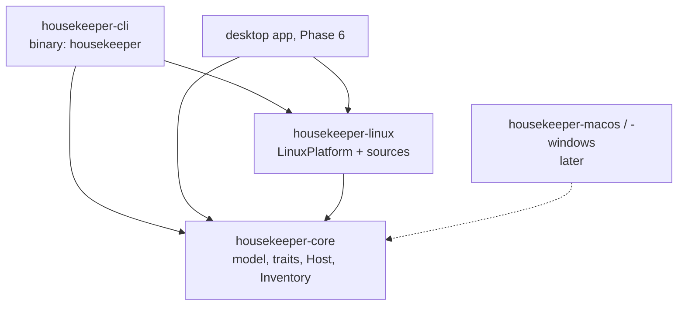

# Architecture

An illustrated walkthrough of this document, including a step-by-step example of adding a distribution, is in
[guide.html](guide.html) (open it in a browser).

## Layers



- **`housekeeper-core`** knows nothing about any operating system. It defines the model (`Package`, `SourceInfo`),
  the extension points (traits), the `Host` that sources read the machine through, and services such as
  `Inventory`.
- **`housekeeper-linux`** implements a `Platform` for Linux and one `Source` per way software gets installed.
- **Front ends** (`housekeeper-cli`, later the Tauri app) pick the platform for the OS they were built for and talk
  only to core services.

Adding an operating system means adding one crate that implements `Platform` and its sources. Nothing in core or in
the Linux crate changes.

## Composition, not inheritance

Rust has no class inheritance; Housekeeper is assembled from small objects behind traits.

| Trait | Role | Implemented by |
|---|---|---|
| `Platform` | Describes the system and owns the list of sources | `LinuxPlatform` |
| `Source` | One way software gets installed: dpkg, Flatpak, Homebrew, npm… Reports availability and inventory | `DpkgSource`, `FlatpakSource`, `HomebrewSource`, … |
| `LinuxSource` | How a Linux source is created, and whether it is a distribution's native package manager | every Linux source |
| `OwnerLookup` | Optional ability: which paths belong to an installed package | `DpkgSource`, `RpmSource`, `PacmanSource` |
| `CommandRunner` | Runs a program (argv only, never a shell) with a timeout | `SystemRunner`, `FakeRunner` (tests) |

Abilities that only some sources have are separate traits, exposed by a source as optional components rather than
as methods every source must stub out:

```rust
trait Source {
    fn info(&self) -> SourceInfo;
    fn probe(&self, host: &Host) -> Availability;
    fn inventory(&self, host: &Host) -> Result<Vec<Package>, SourceError>;
    fn owner_lookup(&self) -> Option<&dyn OwnerLookup> { None }      // native package managers
    // Added in later phases, each defaulting to None:
    // fn remover(&self) -> Option<&dyn Remover> { None }             // Phase 3
    // fn file_installer(&self) -> Option<&dyn FileInstaller> { None } // Phase 5
    // fn updater(&self) -> Option<&dyn Updater> { None }             // Phase 7
}
```

A front end asks "can this source remove things?" by checking for the component, so a new capability never forces
changes on sources that don't support it.

### Adding a provider is one file

Every file in `crates/linux/src/sources/` is a source and registers itself: `crates/linux/build.rs` finds the file's
`impl LinuxSource for <Type>` and adds it to the generated provider list. Nothing else is edited.

```rust
// crates/linux/src/sources/homebrew.rs (the whole registration)
pub struct HomebrewSource;

impl LinuxSource for HomebrewSource {
    fn create(_: &Context<'_>) -> Self { Self }
}
impl Source for HomebrewSource { /* info, probe, inventory */ }
```

A distribution's own package manager also declares which distributions it serves, so supporting a new distribution
is the same single file:

```rust
impl LinuxSource for DpkgSource {
    const NATIVE: Option<Native> = Some(Native {
        families: &[Family { name: "debian", distro_ids: &["debian", "ubuntu", "linuxmint", /* … */] }],
        program: "dpkg-query",
    });
    fn create(_: &Context<'_>) -> Self { Self }
}
```

`LinuxPlatform` matches the distribution's `ID`, then each `ID_LIKE` entry, against every native source's families,
creates that one native source first, and passes it to the others through `Context` (the manual source asks its
`owner_lookup()` which files a package owns). It never names a source.

### The Host

Sources never touch `std::fs` paths or `std::process` directly. They go through `Host`:

- `host.path("/var/lib/dpkg/status")` resolves a system path under the host's root (`/` normally, a fixture
  directory in tests).
- `host.home()` and `host.var("CARGO_HOME")` give the user's home and environment.
- `host.run(&cmd)` executes through the injected `CommandRunner`.

This is what makes every source testable with recorded output and fixture files. The runner is swapped only for tests:
Housekeeper inspects the machine it runs on and no other (D22).

## Decisions

Each challenge raised during design review, and the decision taken.

| # | Challenge | Decision |
|---|---|---|
| D1 | Package-manager output changes between versions (apt 3, dnf5) | Use stable machine interfaces only: `dpkg-query --showformat`, `rpm --queryformat`, pacman's local database files, the snapd REST API, metadata files for pipx, cargo and npm. Force `LC_ALL=C`. Keep fixtures per distro; smoke-test inside real distro containers in CI. |
| D2 | Several package managers can be present (rpm on Ubuntu) | Exactly one native source, chosen from `os-release` (`ID`, then each `ID_LIKE` entry) against the families each native source declares; on a distribution no family claims, the first native source (in file-name order) whose program is installed. |
| D3 | Image-based distros (Silverblue, Kinoite; openSUSE Aeon, MicroOS) | Detect `/run/ostree-booted`. rpm lists the image; packages the user layered (`rpm-ostree status --json`) are the user's apps. Removal goes through `rpm-ostree` and needs a reboot, and the plan says so. openSUSE's image-based systems use `transactional-update` instead of rpm-ostree; they are detected and handled by their own package tool (D24). |
| D4 | Running as root is dangerous | The app and CLI never run as root. Changes that need root go to a separate `housekeeper-helper` started with `pkexec`, which accepts one typed operation (JSON on stdin), checks each name against the native package database itself (D25) and runs argv vectors, never shell strings. |
| D5 | Removing a package can drag system packages with it | Always simulate first through the package manager and show everything that would go. Protected packages (dpkg Essential / Priority required, pacman `base`, dnf `protected_packages`) block the plan. |
| D6 | Package-manager locks (apt running in the background) | Scans never take locks. Changes run one per backend at a time; a held lock shows as "waiting for apt" instead of failing. |
| D7 | Deleting leftovers loses data | Leftovers go to the freedesktop Trash. User data is only included when the user ticks it. |
| D8 | "Remove it the way its installer intended" for script installs | Tiered strategy (own uninstaller → package manager → format convention → recipe → tracked manifest → unknown). Recipes are TOML data files reviewed in this repo, using a fixed action vocabulary (run a program inside the install, trash a path under allowed roots), never free shell. TOML rather than YAML: `serde_yaml` is unmaintained. |
| D9 | Store pages are untrusted HTML shown in a privileged app (XSS) | Store data is fetched by the Rust backend, descriptions are converted to sanitised text, the webview has a strict CSP with no remote scripts, and the frontend only calls a small set of typed commands. |
| D10 | Store APIs are public but not guaranteed | Send a `User-Agent`, cache responses, ship a snapshot fallback, degrade to "store unavailable" without breaking the rest of the app. |
| D11 | Malicious apps in stores | Show source, publisher verification and sandbox permissions before install. Nothing installs without an explicit confirmation. |
| D12 | Slow scans | Sources are scanned in parallel threads. Read files directly where the format is stable (pacman, pipx, cargo, npm) instead of spawning interpreters. Commands have timeouts. |
| D13 | Async runtime | Core is synchronous and uses threads. The desktop app calls it on a blocking worker. No async runtime in core. |
| D14 | A failing source must not break the scan | Each source reports its own status (`ok`, `unavailable`, `failed: reason`); the rest of the inventory still shows. |
| D15 | Sign-in and telemetry | None in v1. Optional GitHub Gist backup later (Phase 12). |
| D16 | Distribution | Native packages built with [nfpm](https://nfpm.goreleaser.com) from one definition (`packaging/nfpm.yaml`): `.deb`, `.rpm`, Arch `.pkg.tar.zst`, plus a tarball, for x86_64 and aarch64, attached to every GitHub release. The desktop app's packages will also install the polkit policy and helper. Flatpak is not used: its sandbox cannot manage host packages. The AppImage runs in portable mode. |
| D17 | Name | "Housekeeper". "Linux" in a product name needs a Linux Foundation sublicence. |
| D18 | One binary for every distribution | The CLI is linked statically against musl, so the same file runs on old and new distributions regardless of their glibc. All dependencies are pure Rust, so this costs nothing. |
| D19 | Proving it works on each distribution | CI installs every package with the native package manager in containers of each supported release (Debian, Ubuntu, Fedora, AlmaLinux, openSUSE, Arch; x86_64 and aarch64), runs it against the real package database, checks it lists its own package, and removes it. Silverblue is checked from its official image using the tarball. |
| D20 | Adding a provider must not mean editing lists | Every file in `crates/linux/src/sources/` implements `Source` + `LinuxSource` and is registered by `build.rs`, which finds its `impl LinuxSource for <Type>`; a file without exactly one such impl fails the build with a clear message. Native package managers declare their families in the same file and offer `OwnerLookup` themselves. Explicit registration (one line per source) was the alternative; generated registration was chosen so a provider is exactly one file. |
| D21 | Licence: nobody may turn Housekeeper into closed software | GNU GPL v3.0 or later. Anyone distributing it, modified or not, must provide the source under the same licence. "Or later" (the FSF's recommendation) lets the project move to a future GPL version without asking every contributor. MIT and Apache-2.0 were rejected because they allow closed forks; AGPL was not needed because Housekeeper is not a network service. Dependencies stay permissive (MIT, Apache-2.0, Unicode-3.0), all GPL-compatible; `cargo deny` enforces it. |
| D22 | Managing other computers (over SSH) | Not planned. Housekeeper manages only the machine it runs on; `Host` and `CommandRunner` stay local, and the runner is swapped only for tests. Earlier documents disagreed on how it would work (swap the runner, run `housekeeper --json` on the other machine, install nothing there), and swapping the runner alone could not work because `Host` reads files locally. Bringing it back needs a new decision that picks one design. |
| D24 | Reading packages and changing them are different jobs: rpm is read on Fedora, openSUSE and Silverblue, but changed through dnf, zypper or rpm-ostree (and dpkg through apt, pacman's AUR through paru or yay) | The native source reads the package database (dpkg, rpm, pacman) and stays one per system (D2). Changing packages (simulate, remove, install, update, hold) belongs to a **package tool**: one file per tool (apt, dnf, zypper, rpm-ostree, transactional-update, pacman, an AUR helper) in its own folder of `crates/linux/src/`, registered like sources (D20), declaring the families or `os-release` IDs it serves and when it applies (image-based or not). `LinuxPlatform` picks the tool the same way it picks the native source, and the native source's `remover()` and later abilities come from that tool. A database file therefore never branches on distribution, and a distribution that shares a database but not a tool (Mageia, PCLinuxOS) is one new tool file. Settled before Phase 3.1. |
| D25 | Who carries out a removal | Every step of a removal plan says who runs it: the user, or the root helper (D4). Items in the user's own scope (npm under nvm or fnm, pipx, uv, cargo, `pip --user`, `~/.local`, user Flatpaks, Homebrew) are removed as the user. Tools that authorise system changes themselves (snapd, Flatpak's system helper) also run as the user and ask through polkit on their own. The root helper only takes what needs root and has no such tool: operations of the native package tool (D24), and recipe actions on system paths under D8's allowed roots (such as `/opt`). It checks each package name against the package database itself (`dpkg-query`, `rpm -q`, pacman's database) and never runs a scan: as root, the home directory and environment are root's, so user-scope sources would read the wrong places, and the helper would carry code it does not need. |
| D26 | A script-installed tool is described in two places (detection in Rust, removal in a recipe) | One TOML recipe per tool (D8) holds both: how to detect it (install roots, the environment variables that move them, a marker file) and how to remove it. The manual source reads its list of script installers from the recipes, which are compiled into the binary so it stays one file. The Rust `INSTALLERS` table in `manual.rs` moves into recipes when the recipe format lands (Phase 3.4). Adding a script-installed tool is then one reviewed TOML file and no Rust. |
