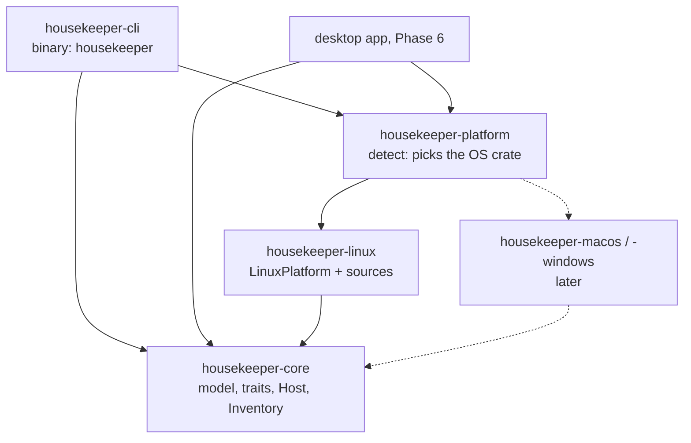

# Architecture

An illustrated walkthrough of this document, including a step-by-step example of adding a distribution, is in
[guide.html](guide.html) (open it in a browser).

## Layers



- **`housekeeper-core`** knows nothing about any operating system and builds on any of them. It defines the model
  (`Package`, `SourceInfo`), the extension points (traits), the `Host` that sources read the machine through, and
  services such as `Inventory`.
- **`housekeeper-linux`** implements a `Platform` for Linux and one `Source` per way software gets installed.
- **`housekeeper-platform`** is the one place that knows which OS crate to use: `detect(&host)` returns the
  `Platform` for the OS it was built for, or `Unsupported`. Only it depends on the OS crates (D27).
- **Front ends** (`housekeeper-cli`, later the Tauri app) call `housekeeper_platform::detect` and then talk only to
  core services.

Adding an operating system means adding one crate that implements `Platform` and its sources, and registering it in
`housekeeper-platform` (its `detect` and a target-specific dependency). Nothing in core, in the Linux crate or in the
front ends changes.

## Composition, not inheritance

Rust has no class inheritance; Housekeeper is assembled from small objects behind traits.

| Trait | Role | Implemented by |
|---|---|---|
| `Platform` | Describes the system, owns the list of sources, and lists the application menu's launchers, the app catalog entries on disk and the folders commands live in | `LinuxPlatform` (desktop entries, AppStream metainfo, `PATH` plus the standard program folders) |
| `Source` | One way software gets installed: dpkg, Flatpak, Homebrew, npm… Reports availability and inventory | `DpkgSource`, `FlatpakSource`, `HomebrewSource`, … |
| `LinuxSource` | How a Linux source is created, and whether it is a distribution's native package manager | every Linux source |
| `OwnerLookup` | Optional ability: which installed packages own each of a set of paths | `DpkgSource`, `RpmSource`, `PacmanSource` |
| `FileList` | Optional ability: the files one package installed, as the source records them | `DpkgSource`, `RpmSource`, `PacmanSource`, `PipSource` (`RECORD`), `CargoSource` (its binaries) |
| `Dependants` | Optional ability: which installed packages of the same source directly need one package | `DpkgSource`, `RpmSource`, `PacmanSource`, `FlatpakSource` (apps on a runtime), `SnapSource` (base and content snaps) |
| `CommandRunner` | Runs a program (argv only, never a shell) with a timeout | `SystemRunner`, `FakeRunner` (tests) |

Abilities that only some sources have are separate traits, exposed by a source as optional components rather than
as methods every source must stub out:

```rust
trait Source {
    fn info(&self) -> SourceInfo;
    fn probe(&self, host: &Host) -> Availability;
    fn inventory(&self, host: &Host, scan: &ScanContext) -> Result<Vec<Package>, SourceError>;
    fn owner_lookup(&self) -> Option<&dyn OwnerLookup> { None }      // native package managers
    fn file_list(&self) -> Option<&dyn FileList> { None }            // package managers, pip, cargo
    fn dependant_lookup(&self) -> Option<&dyn Dependants> { None }   // package managers, Flatpak, Snap
    fn install_roots(&self, host: &Host) -> Vec<PathBuf> { vec![] }  // where its programs live (pipx, npm…)
    // Added in later phases, each defaulting to None:
    // fn remover(&self) -> Option<&dyn Remover> { None }             // Phase 3
    // fn file_installer(&self) -> Option<&dyn FileInstaller> { None } // Phase 5
    // fn updater(&self) -> Option<&dyn Updater> { None }             // Phase 7
}
```

A front end asks "can this source remove things?" by checking for the component, so a new capability never forces
changes on sources that don't support it.

### Adding a provider is one file

Every file in `crates/linux/src/sources/` is a source and registers itself: `crates/linux/build.rs` declares the file
as a module and adds its `PROVIDER` to the generated provider list, and the file defines `PROVIDER` with
`register!(<Type>);`. Nothing else is edited. A file without `register!` fails to compile.

```rust
// crates/linux/src/sources/homebrew.rs (the whole registration)
pub struct HomebrewSource;

impl LinuxSource for HomebrewSource {
    fn create(_: &Context<'_>) -> Self { Self }
}
register!(HomebrewSource);
impl Source for HomebrewSource { /* info, probe, inventory */ }
```

A distribution's own package manager also declares which distributions it serves, so supporting a new distribution
is the same single file:

```rust
impl LinuxSource for DpkgSource {
    const NATIVE: Option<Native> = Some(Native {
        families: &[Family { name: "debian", distro_ids: &["debian", "ubuntu", "linuxmint", /* … */] }],
        program: "dpkg-query",
    });
    fn create(_: &Context<'_>) -> Self { Self }
}
```

`LinuxPlatform` matches the distribution's `ID`, then each `ID_LIKE` entry, against every native source's families,
and creates that one native source and every other source. It never names a source.

Sources never hold each other. While a source is read, its `ScanContext` gives it every source of the platform
and a place for warnings (D23). The manual source uses it to leave out what others account for: paths a native
source's `owner_lookup()` says it owns, and programs that resolve into another source's `install_roots()`.

The same three answers make `Housekeeper::who` ("who installed this?") in core: for a command or file it follows
the symlinks and, file by file, takes the first source that accounts for one: a package database that lists it
(`owner_lookup()`), a package whose install location contains it (`Package::location`, the deepest one along the
chain), or a source folder that contains it (`install_roots()`). It names no source, so a new source is covered as
soon as it reports locations or install roots.

Every scan uses the same evidence, in one batch, to give packages their launchers and commands (D28): each desktop
entry (the file, then the files it hides, then the program its `Exec` starts) and each program in the command
folders is traced to its package, but a command counts only when a package database lists it. A package with a menu
entry or a command is an `App`; one whose package database answered and that has neither is a `Component` (fonts,
firmware, data), which `housekeeper list` hides without `--all`. The main launcher gives a title and an icon when
the source has none.

The same pass reads the app catalog entries on disk (`Platform::metainfo`: AppStream metainfo on Linux) and gives
their component IDs to the package that accounts for the file, or else to the package whose launcher the entry names.
Sources that know their packages' AppStream IDs report them too (a Flatpak's ID, a snap's `common-id`). The scan then
groups the apps installed more than once (`Scan::groups`, D29): installs that share an AppStream or launcher ID, a
name or a command. Packages stay separate; a group only lists them and what they share.

`Housekeeper::show` takes one package from a scan and adds what only that package needs (D30): its files, from the
source's `file_list()` when the source records them, otherwise everything in its install location; the packages of
the same source that directly need it, from `dependant_lookup()`; and its other installs from the scan's groups.

### The Host

Sources never touch `std::fs` paths or `std::process` directly. They go through `Host`:

- `host.path("/var/lib/dpkg/status")` resolves a system path under the host's root (`/` normally, a fixture
  directory in tests).
- `host.home()` and `host.var("CARGO_HOME")` give the user's home and environment.
- `host.run(&cmd)` executes through the injected `CommandRunner`.

This is what makes every source testable with recorded output and fixture files. The runner is swapped only for tests:
Housekeeper inspects the machine it runs on and no other (D22).

## Decisions

Each challenge raised during design review, and the decision taken.

| # | Challenge | Decision |
|---|---|---|
| D1 | Package-manager output changes between versions (apt 3, dnf5) | Use stable machine interfaces only: `dpkg-query --showformat`, `rpm --queryformat`, pacman's local database files, the snapd REST API, metadata files for pipx, cargo and npm. Force `LC_ALL=C`. Keep fixtures per distro; smoke-test inside real distro containers in CI. |
| D2 | Several package managers can be present (rpm on Ubuntu) | Exactly one native source, chosen from `os-release` (`ID`, then each `ID_LIKE` entry) against the families each native source declares; on a distribution no family claims, the first native source (in file-name order) whose program is installed. |
| D3 | Image-based distros (Silverblue, Kinoite; openSUSE Aeon, MicroOS) | Detect `/run/ostree-booted`. rpm lists the image; packages the user layered (`rpm-ostree status --json`) are the user's apps. Removal goes through `rpm-ostree` and needs a reboot, and the plan says so. openSUSE's image-based systems use `transactional-update` instead of rpm-ostree; they are detected and handled by their own package tool (D24). |
| D4 | Running as root is dangerous | The app and CLI never run as root. Changes that need root go to a separate `housekeeper-helper` started with `pkexec`, which accepts one typed operation (JSON on stdin), checks each name against the native package database itself (D25) and runs argv vectors, never shell strings. |
| D5 | Removing a package can drag system packages with it | Always simulate first through the package manager and show everything that would go. Protected packages (dpkg Essential / Priority required, pacman `base`, dnf `protected_packages`) block the plan. |
| D6 | Package-manager locks (apt running in the background) | Scans never take locks. Changes run one per backend at a time; a held lock shows as "waiting for apt" instead of failing. |
| D7 | Deleting leftovers loses data | Leftovers go to the freedesktop Trash. User data is only included when the user ticks it. |
| D8 | "Remove it the way its installer intended" for script installs | Tiered strategy (own uninstaller → package manager → format convention → recipe → tracked manifest → unknown). Recipes are TOML data files reviewed in this repo, using a fixed action vocabulary (run a program inside the install, trash a path under allowed roots), never free shell. TOML rather than YAML: `serde_yaml` is unmaintained. |
| D9 | Store pages are untrusted HTML shown in a privileged app (XSS) | Store data is fetched by the Rust backend, descriptions are converted to sanitised text, the webview has a strict CSP with no remote scripts, and the frontend only calls a small set of typed commands. |
| D10 | Store APIs are public but not guaranteed | Send a `User-Agent`, cache responses, ship a snapshot fallback, degrade to "store unavailable" without breaking the rest of the app. |
| D11 | Malicious apps in stores | Show source, publisher verification and sandbox permissions before install. Nothing installs without an explicit confirmation. |
| D12 | Slow scans | Sources are scanned in parallel threads. Read files directly where the format is stable (pacman, pipx, cargo, npm) instead of spawning interpreters. Commands have timeouts. `Housekeeper::scan_with` hands each source's result to a callback as soon as that source finishes, so the desktop app can show progress per source. |
| D13 | Async runtime | Core is synchronous and uses threads. The desktop app calls it on a blocking worker. No async runtime in core. |
| D14 | A failing source must not break the scan | Each source reports its own status (`ok`, `unavailable`, `failed: reason`); the rest of the inventory still shows. |
| D15 | Sign-in and telemetry | None in v1. Optional GitHub Gist backup later (Phase 12). |
| D16 | Distribution | Native packages built with [nfpm](https://nfpm.goreleaser.com) from one definition (`packaging/nfpm.yaml`): `.deb`, `.rpm`, Arch `.pkg.tar.zst`, plus a tarball, for x86_64 and aarch64, attached to every GitHub release. The desktop app's packages will also install the polkit policy and helper. Flatpak is not used: its sandbox cannot manage host packages. The AppImage runs in portable mode. |
| D17 | Name | "Housekeeper". "Linux" in a product name needs a Linux Foundation sublicence. |
| D18 | One binary for every distribution | The CLI is linked statically against musl, so the same file runs on old and new distributions regardless of their glibc. All dependencies are pure Rust, so this costs nothing. |
| D19 | Proving it works on each distribution | CI installs every package with the native package manager in containers of each supported release (Debian, Ubuntu, Fedora, AlmaLinux, openSUSE, Arch; x86_64 and aarch64), runs it against the real package database, checks it lists its own package, and removes it. Silverblue is checked from its official image using the tarball. |
| D20 | Adding a provider must not mean editing lists | Every file in `crates/linux/src/sources/` implements `Source` + `LinuxSource` and calls `register!(<Type>)`, which defines its `PROVIDER`. `build.rs` only lists the files: it declares one module per file and adds its `PROVIDER` to the generated list, so the compiler reports a file without `register!`. Sources never import from each other; code they share lives outside `sources/` (`files.rs`, `python.rs`). Native package managers declare their families in the same file and offer `OwnerLookup` themselves. Explicit registration (one line per source) was the alternative; generated registration was chosen so a provider is exactly one file. Finding `impl LinuxSource for` in the source text was tried first and dropped: comments and strings fooled it and the compiler could not check it. |
| D21 | Licence: nobody may turn Housekeeper into closed software | GNU GPL v3.0 or later. Anyone distributing it, modified or not, must provide the source under the same licence. "Or later" (the FSF's recommendation) lets the project move to a future GPL version without asking every contributor. MIT and Apache-2.0 were rejected because they allow closed forks; AGPL was not needed because Housekeeper is not a network service. Dependencies stay permissive (MIT, Apache-2.0, Unicode-3.0), all GPL-compatible; `cargo deny` enforces it. |
| D22 | Managing other computers (over SSH) | Not planned. Housekeeper manages only the machine it runs on; `Host` and `CommandRunner` stay local, and the runner is swapped only for tests. Earlier documents disagreed on how it would work (swap the runner, run `housekeeper --json` on the other machine, install nothing there), and swapping the runner alone could not work because `Host` reads files locally. Bringing it back needs a new decision that picks one design. |
| D23 | Sources that depend on other sources (the manual source must leave out what package managers, pipx, npm… installed) | Sources reach each other only at scan time, through the `ScanContext` passed to `inventory`: it lists every source of the platform and collects warnings. Each source declares where its programs live (`install_roots`), so a new source is never listed twice as a hand install and no other file knows its directories. A source that cannot fully answer (an owner lookup that times out) still reports what it found, with a warning, instead of failing. Construction-time wiring (`Context` holding the native source) was replaced because every new dependency between sources needed a new field. |
| D24 | Reading packages and changing them are different jobs: rpm is read on Fedora, openSUSE and Silverblue, but changed through dnf, zypper or rpm-ostree (and dpkg through apt, pacman's AUR through paru or yay) | The native source reads the package database (dpkg, rpm, pacman) and stays one per system (D2). Changing packages (simulate, remove, install, update, hold) belongs to a **package tool**: one file per tool (apt, dnf, zypper, rpm-ostree, transactional-update, pacman, an AUR helper) in its own folder of `crates/linux/src/`, registered like sources (D20), declaring the families or `os-release` IDs it serves and when it applies (image-based or not). `LinuxPlatform` picks the tool the same way it picks the native source, and the native source's `remover()` and later abilities come from that tool. A database file therefore never branches on distribution, and a distribution that shares a database but not a tool (Mageia, PCLinuxOS) is one new tool file. Settled before Phase 3.1. |
| D25 | Who carries out a removal | Every step of a removal plan says who runs it: the user, or the root helper (D4). Items in the user's own scope (npm under nvm or fnm, pipx, uv, cargo, `pip --user`, `~/.local`, user Flatpaks, Homebrew) are removed as the user. Tools that authorise system changes themselves (snapd, Flatpak's system helper) also run as the user and ask through polkit on their own. The root helper only takes what needs root and has no such tool: operations of the native package tool (D24), and recipe actions on system paths under D8's allowed roots (such as `/opt`). It checks each package name against the package database itself (`dpkg-query`, `rpm -q`, pacman's database) and never runs a scan: as root, the home directory and environment are root's, so user-scope sources would read the wrong places, and the helper would carry code it does not need. |
| D26 | A script-installed tool is described in two places (detection in Rust, removal in a recipe) | One TOML recipe per tool (D8) holds both: how to detect it (install roots, the environment variables that move them, a marker file) and how to remove it. The manual source reads its list of script installers from the recipes, which are compiled into the binary so it stays one file. The Rust `INSTALLERS` table in `manual.rs` moves into recipes when the recipe format lands (Phase 3.4). Adding a script-installed tool is then one reviewed TOML file and no Rust. |
| D27 | Core must build on any OS, and every front end must pick the platform the same way | Core keeps Unix-only code (execute bits in `host.rs` and `command.rs`) behind `cfg(unix)`; elsewhere any file counts as executable. A small crate, `housekeeper-platform`, exposes `detect(&host) -> Result<Box<dyn Platform>, Unsupported>` and is the only crate that depends on an OS crate, each as a target-specific dependency. Front ends call it and depend on core otherwise. The alternative, each front end keeping its own `cfg(target_os)` functions, was rejected: the desktop app would have to copy them and could drift from the CLI. |
| D28 | Telling apps from the rest of a native package database: dpkg, rpm and pacman say nothing about which packages a person launches, so every package someone marked as installed on purpose was listed (448 on an Ubuntu desktop: fonts, firmware, Python modules, data) | A package is an `App` when it has a launcher shown in the application menu or a command a package database lists in the command folders, and a `Component` (hidden without `--all`) when its package database answered and it has neither. The platform lists launchers (`Platform::launchers`: desktop entries on Linux, read as the freedesktop.org specification says, one per desktop ID, the one that takes precedence) and command folders (`Platform::command_dirs`: the `PATH` plus the standard program folders); core attaches both with `who`'s evidence (D23), in one batched ownership query per package database that runs while the sources are read. A launcher goes to the first of its file, the files it hides, and its `Exec` program that a source accounts for, so a user's copy of a Flatpak entry stays with the Flatpak app rather than the `flatpak` package its command line runs. Each source reporting its own launchers was rejected: the evidence chain would be repeated in every source and a desktop file in `~/.local` names no source. Classifying by package section or name (`fonts-*`, `Section: libs`) was rejected: it differs per distribution and misses data packages with ordinary names. rpm lists every installed file once (`rpm -qa`) instead of `rpm -qf` when more than 64 paths are asked, because `rpm -qf` prints an owning package's whole file list once per path. |
| D29 | The same app installed more than once (a `.deb` and a snap, npm under two Node versions) shows as unrelated rows, but merging them would hide which copy runs and how each is removed | Packages stay separate; `Scan::groups` lists the installs of one app and what they share. Two packages are linked when they share an AppStream ID (catalog entries attached like launchers, a Flatpak's ID, a snap's `common-id`), a launcher ID (compared with AppStream IDs, without `.desktop` or case), a name or title (lowercase letters and digits), or a command, and links are followed transitively. Only `App` packages take part: libraries and components of one name are parts, not installs. Within one source only packages of the same name are linked, because a package database splits one install into parts that share a title (`vim` and `vim-common`). Matching on AppStream IDs alone was rejected: on an Ubuntu desktop no two installs shared one, while names, titles and commands found all four real duplicates. A name match can join unrelated software that shares a name; the group lists what was shared so the evidence is visible. |
| D30 | `housekeeper show` needs a package's files and what depends on it, which only some sources record, and an install location is not always the package's alone (every `cargo install` shares `~/.cargo/bin`; a pip package's location is its `.dist-info` folder) | Two optional abilities, `FileList` (`file_list()`) and `Dependants` (`dependant_lookup()`), offered by the sources that record them: dpkg (`dpkg-query --listfiles`, Depends/Pre-Depends against the package's name and Provides), rpm (`rpm -ql`, `--whatrequires` on what it provides), pacman (its local database's `files` and `%DEPENDS%`/`%PROVIDES%`), pip (`RECORD`), cargo (its binaries), Flatpak (apps on a runtime) and Snap (snaps on a base or using its content). Without `FileList`, a package's files are everything in its install location, symlinked folders listed but not entered. Dependants are direct only and within one source: the full set a removal would take is the package manager's simulation (plan 3.3). Optional dependencies (Recommends, optdepends) do not count. The text shows the first 10 dependants and the full list is in `--json`; the file list is printed only with `--files`. The accessor is `dependant_lookup()`, not `dependants()`, so it does not clash with the trait's own method. |
